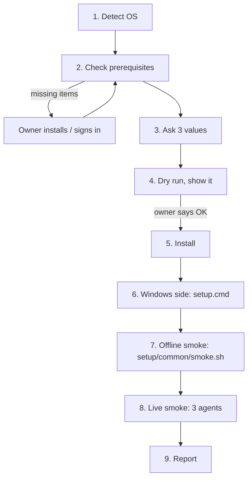

# AGENT_SETUP: set up a new machine

**For the agent.** The owner cloned this repo on a new machine, opened Claude Code (or another agent CLI) in it, and
said "set me up". Follow these steps in order. Do not skip the dry run. Do not invent values: ask, or write
`UNKNOWN`. Talk to the owner in short, plain English (English is the owner's second language).

**Rules while you set up**
- Change only the owner's home folder (what the setup scripts change). Never touch the lab project folders.
- Never run `hc server stop` or `hc server restart` (it kills every Herdr terminal).
- Never open or print token, key or password files. Logins are the owner's job.
- No `git push`. No cloud simulations. Nothing is sent anywhere.
- Each step ends with a check. If a check fails, stop and look in [`docs/TROUBLESHOOTING.md`](docs/TROUBLESHOOTING.md).



---

## 1. Detect the OS

Run:

```bash
uname -s
grep -qi microsoft /proc/version 2>/dev/null && echo WSL || echo not-WSL
```

| Result | Machine | Go to |
|---|---|---|
| `Linux` + `WSL` | Windows PC, inside WSL | the **Windows** steps |
| `Darwin` | Mac | the **Mac** steps (section M) |
| `Linux` + `not-WSL` | plain Linux: not supported yet | stop, tell the owner |
| no `uname` (PowerShell) | Windows, but not inside WSL | tell the owner: open **Ubuntu** and start Claude Code there |

The framework runs inside WSL on Windows. Claude Code must run in Ubuntu, not in PowerShell.

---

## Windows steps

### 2. Check prerequisites

Run each check. Collect what is missing. Then give the owner ONE list of what they must do.

| Item | Check (run it) | If missing: who does it |
|---|---|---|
| WSL distro named `Ubuntu` | `echo $WSL_DISTRO_NAME` prints `Ubuntu` | **Owner**, in admin PowerShell: `wsl --install -d Ubuntu`. `setup.cmd` and the shortcuts call `wsl.exe -d Ubuntu`, so the name must be `Ubuntu`. |
| Git, Python 3, tmux | `git --version`, `python3 --version`, `tmux -V` | Agent may run `sudo apt install git python3 tmux` (the owner types the sudo password). tmux is the fallback live host. |
| GitHub CLI + login | `gh auth status` | **Owner**: `sudo apt install gh`, then `gh auth login`. |
| Herdr desktop app | `ls "/mnt/c/Users/{{WIN_USER}}/AppData/Local/Programs/herdr-app/herdr-app.exe"` | **Owner** installs Herdr for Windows (vendor installer). |
| herdr-core (`hc.exe`) | `ls "/mnt/c/Users/{{WIN_USER}}/AppData/Local/Programs/herdr-core/hc.exe"` | comes with Herdr. ck-run's Herdr host and `ck-herdr` use this path. |
| Claude Code | `claude --version` | **Owner** installs (vendor page; on this PC it lives in `~/.local/bin/claude`) and signs in: `claude`, then `/login`. |
| Codex CLI (sol, astra) | `codex --version` | **Owner** installs (vendor page) and signs in: `codex login`. |
| Cursor agent CLI (grok, composer) | `agent --version` or `cursor-agent --version` | **Owner** installs (vendor page) and signs in: `agent login`. If only `cursor-agent` exists: `ln -s "$(command -v cursor-agent)" ~/.local/bin/agent`. |
| agy (gemini) | `agy --version` | Optional. Not installed on the source PC either. Only the `gemini` alias needs it. Login method: UNVERIFIED. |
| Tailscale | Windows: Tailscale app signed in | Only for phone access. **Owner**. See [`docs/PHONE.md`](docs/PHONE.md). |
| Windows Terminal | optional | Only the tmux fallback uses it. Without it: `export CK_NO_WT=1`. |

Vendor install pages (the exact install line can change; read the page, UNVERIFIED in this repo):
Claude Code `https://docs.anthropic.com/en/docs/claude-code`, Codex `https://github.com/openai/codex`,
Cursor CLI `https://cursor.com/cli`.

Say to the owner, for example:

> Please do these yourself, then tell me "done": 1. `gh auth login` 2. `codex login` 3. `agent login`.

Check again after "done". Logins are never done by you.

### 3. Ask the 3 values

Ask all three in one message. Offer the default in brackets.

| Value | Question | Default | Used as |
|---|---|---|---|
| Windows user | "What is your Windows user name?" | the folder name under `/mnt/c/Users/` (`ls /mnt/c/Users`) | `--win-user` → `{{WIN_USER}}` |
| PhD folder | "Where is your full PhD folder, as a WSL path?" | Offer `/mnt/c/Users/<user>/Documents/PhD` only if that folder exists; otherwise no default | `--phd-root` → `{{PHD_ROOT}}`. If it is inside OneDrive, the path has the OneDrive folder name in it. Use the real path. |
| Projects | "Which projects do you use here? devfab (Device Fabrication), nv (NV Compact Magnetometer), washu (Coursework)" | all that exist | no setup flag: you use it to check folders (below) |

Then check the projects:

```bash
PHD="<the PhD folder>"
ls -d "$PHD/Device Fabrication" "$PHD/NV Compact Magnetometer" "$PHD/Coursework" 2>&1
```

- A chosen project folder is missing: the owner must restore it first (OneDrive or backup). Its rule files and wiki
  live there, not in this repo.
- `Device Fabrication` missing: setup warns and skips its local `superpowers` plugin. The rest continues.
  Restore the folder, then rerun setup with the same values to install that plugin.
- Shortcuts are fixed: `cdev` = Device Fabrication, `cnv` = NV Compact Magnetometer, `gb` = `~/PhD_local`.
  A shortcut for a missing folder just fails to `cd`.

### 4. Dry run, and show it

From the repo folder (in WSL):

```bash
bash setup/windows/setup.sh --dry-run --win-user "<WIN_USER>" --phd-root "<PHD_ROOT>"
```

It prints one `DRY-RUN ...` line per action and changes nothing. Show the owner a short version:

- where files go (`~/PhD_local/ck-dispatch`, `ckstack`, `grokbot-mod`, `grok-bot-skills`, `~/.local/bin/ck-run`,
  `~/.ck_shortcuts.sh`, the `.bashrc` line),
- the plugin lines (`claude plugin marketplace add ...`, `claude plugin install ...`),
- the settings merge (`theme`, `modelSettings`, `agentPushNotifEnabled` into `~/.claude/settings.json`, with `.bak`),
- the last step: offline tests (`python3 -I ~/PhD_local/ck-dispatch/tests/run_all.py`).

Always pass `--phd-root` when there is no terminal or when using `--yes`, including a dry run.
Without it, setup stops before changing files and asks for the full WSL path. In a terminal, setup asks for the
Windows user and full PhD folder even during a dry run. An environment `PHD_ROOT` is offered only if it exists;
otherwise the user must type the path.

You may also preview the Windows side (safe, it changes nothing):

```bash
cmd.exe /c "$(wslpath -w setup/windows/setup.cmd)" --dry-run
```

Wait for the owner's OK.

### 5. Install (WSL side)

```bash
bash setup/windows/setup.sh --yes --win-user "<WIN_USER>" --phd-root "<PHD_ROOT>"
```

- `--yes`: no prompts; it uses the values you pass.
- It copies `core/` into `~/PhD_local`, fills the placeholders, links `~/.local/bin/ck-run`, adds the shortcuts,
  adds the Claude marketplaces and installs the plugins in `setup/common/claude/plugins.txt` (skipping a local
  plugin with a warning if its project folder is missing), copies the plugin
  prefs, merges the Claude settings, then runs the offline tests.
- The tests take a few minutes (on the source build: 402 tests in about 263 s, `verification/offline-suite-final.log`).
- Offline machine: add `--no-plugins` (skills still install). Short on time: add `--no-tests` and run the tests later.
- Safe to repeat: a second run keeps the same files.

Check: the last line is `DONE. Open a new terminal for the PATH and shortcuts.` and the tests end with `OK`.
A line `Setup failed: ...` means stop: see [`docs/TROUBLESHOOTING.md`](docs/TROUBLESHOOTING.md) "Setup".

### 6. Windows side: `setup.cmd` (the owner runs it)

`setup.cmd` first asks for the Windows user and full PhD folder as a WSL path, in both dry run and install.
It offers a PhD default from `%USERPROFILE%\Documents\PhD` only if that folder exists, converted to a WSL path.
If there is no default, an empty answer stops before changing files. Use the same values as above.
It then copies the `.cmd` shortcuts into `%USERPROFILE%\.local\bin` (and adds it to the user PATH), copies the
Herdr layout `main-ck`, the mods `agents-ck`, `tabs-ck`, `pane-ck`, and the Herdr settings, keys and themes (an old
file different from ours is kept once as `.bak`), switches Herdr to `main-ck`, then runs `setup.sh` again in WSL.

Give the owner the Windows path of the script:

```bash
wslpath -w setup/windows/setup.cmd
```

The owner runs, in a **PowerShell window**, so they can answer the batch script's questions:

```powershell
& "<the path you printed>" --dry-run
& "<the path you printed>"
```

When it asks for the Windows user and full PhD folder, the owner types the same values as in step 3.
The batch script passes both as `--win-user` and `--phd-root`, with `--yes`, to `setup.sh`.
The WSL part runs again with those values (same files, the tests run again). It does not need a WSL prompt.

Check, in a **new** PowerShell window: `where.exe gb` finds `%USERPROFILE%\.local\bin\gb.cmd`. Restart Herdr.

### 7. Offline smoke

In a new WSL terminal (so the PATH is fresh):

```bash
bash setup/common/smoke.sh
```

It runs `ck-run models` and `ck-run --help`. Check: the model table prints, and the last line is
`Offline CLI smoke passed. Use --live to launch opus, sol and grok in auto mode.`

Also check the Claude plugins: `claude plugin list` shows `grokbot@ck-grokbot` and `ckstack@ckstack`.

### 8. Live smoke (3 agents)

This starts real agents. Ask the owner first. It needs the logins from step 2.

**A. In Herdr, through Grok Bot (recommended: it tests the whole chain).** The owner:
1. opens Herdr, makes a space, and types `gb` in its PowerShell tab (or runs `gbh` from PowerShell),
2. says to Grok Bot: `quick smoke test of the 3 agents`.

Grok Bot races opus, sol and grok with `--mode auto`; each agent names its model and runs `date`.
Expected: three panes open on the right of Grok Bot, each turns green; Grok Bot gets woken and prints a finish card.
Codex does not print its model name (`UNKNOWN` is fine). In Device Fabrication, Claude runs end `partial` because of
the wiki-first rule; that is expected for a smoke test.

**B. From a plain WSL terminal.** The owner types `! bash setup/common/smoke.sh --live` (or runs it in Ubuntu). It
opens an ask and races opus, sol, grok with `--mode auto` in the `devfab` workspace (`--workspace nv` or `washu` for
another). From a plain WSL terminal, the runs open in tmux + Windows Terminal, not in Herdr. That is correct
(see [`docs/ARCHITECTURE.md`](docs/ARCHITECTURE.md), "Where the panes open"). Then:
`ck-run race show --ask <the ask id it printed>`.

### 9. Report

Give the owner one short card:

```
Setup on <Windows PC | Mac>: DONE | PARTIAL
Installed: ck-run, Grok Bot mode, ckstack, skills, <N> plugins, shortcuts, Herdr look
Checked: dry run, install, offline tests <OK/FAIL>, offline smoke <OK/FAIL>, live smoke <OK/FAIL/not run>
You must still do: <logins, folders to restore, Tailscale, ...>
Not checked: <items>
```

Keep the full output in `~/PhD_local/agent_runs/setup-report-<date>.md` (create the folder if needed). No user
names, IPs or device names in it beyond this machine.

---

## M. Mac steps

Use [`setup/mac/README.md`](setup/mac/README.md) for the detailed paths and backup rules. The Mac build has offline
proof. Fresh-machine setup, online plugin installs, live windows and phone access remain **UNVERIFIED**.

1. Read the Mac setup guide and `core/ck-dispatch/platform/mac/README.md`. Do not run Windows setup on a Mac.
2. Check prerequisites with `command -v python3 claude codex agent hc herdr-app`. Missing optional agents may be
   skipped. iTerm is the default and fallback. The owner installs apps and handles login; do not read login files.
   **Install Herdr itself** before framework setup if it will be the host. The [vendor](https://herdr.dev/download/)
   offers a terminal script (`curl -fsSL https://releases.herdr.dev/app/install.sh | sh`) or a Mac `.dmg` to drag
   into Applications. The owner runs the chosen installer and opens Herdr once. See the Mac guide for checks.
   Source Mac method: **guess from evidence** — `~/Applications/Herdr.app`, core in `~/.local/share/herdr-core`,
   `hc` linked in `~/.local/bin`, and no app quarantine flag suggest the script rather than the disk image.
   This is an inference, not a verified installation history; both vendor options are documented.
3. Confirm `{{MAC_USER}}`, the full `{{PHD_ROOT}}` parent path, and which project folders have been restored.
   Coursework uses a separate root: confirm `--coursework-root` if the default in the guide is wrong. Check its
   writable course pairs in the installed config before dispatching coursework.
4. Run the dry run and show its plan:

   ```bash
   bash setup/mac/setup.sh --dry-run --mac-user '{{MAC_USER}}' --phd-root '{{PHD_ROOT}}'
   ```

   A noninteractive run needs an explicit PhD path. Do not select a private OneDrive location by guessing.
5. With setup authorized, use the same values for the install:

   ```bash
   bash setup/mac/setup.sh --yes --mac-user '{{MAC_USER}}' --phd-root '{{PHD_ROOT}}'
   ```

   Offline: add `--no-plugins` to both commands. This copies skills but skips Claude marketplace commands.
   Do not test a script revision against the real home. Use the temporary-home commands in the Mac setup guide.
6. Check the installed config points to the actual restored projects. Mac `live.osascript` must end in
   `platform/mac/osascript`; `live.caffeinate` must be `/usr/bin/caffeinate`. Windows config is not changed.
7. Open a new terminal. Check `command -v ck-run`, `ck-run models`, `ck-run --help`, and `bash setup/common/smoke.sh`.
   The installer also runs the offline suite unless `--no-tests` was set. It always runs the short CLI smoke.
8. Select `ck-main` in Herdr after its portable files are installed. `cdev`, `cnv`, `gb` and `grokbot` open Claude
   with Grok Bot activation; `phd` only changes folder. From Herdr, new ck-run agents stay beside the caller.
   Outside Herdr, they use iTerm. Forced hosts are described in the Mac host guide.
9. A live smoke starts real agents. Run `bash setup/common/smoke.sh --live` only within the owner's authorized
   scope. It is separate from offline checks. Do not claim it passed because an installer or fake test passed.
10. Report files changed, checks actually run, and remaining UNVERIFIED items. Give the phone method in
    `docs/PHONE.md`; do not enable Remote Login or add machines as a side effect of installation.
