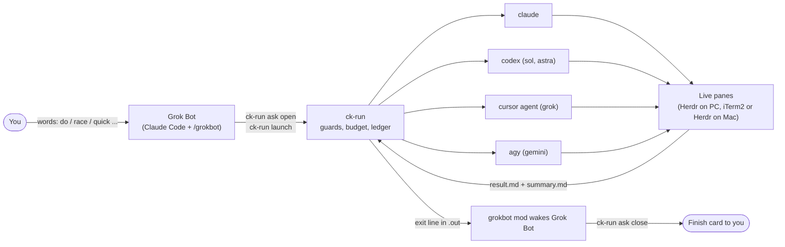

# ck-agentic-framework

One repo for the whole CK agent framework. Clone it on a new Windows PC or Mac, open Claude Code in it,
say **"set me up"**, and the local agent follows [`AGENT_SETUP.md`](AGENT_SETUP.md).

What it holds:

- **ck-run**: the runner. It sends one task to one agent CLI (claude, codex, cursor `agent`, agy), with guards,
  budgets, a run folder, a ledger and a short summary.
- **Grok Bot mode**: a Claude Code plugin (`/grokbot`). Claude Code becomes the orchestrator: it reads your words,
  opens an "ask", starts agents through ck-run, and gives you one start card and one finish card.
- **ckstack**: the router rules, playbooks and small skills that Grok Bot and every agent read.
- **skills**: the lab domain skills (photonics, microwave, wiki rules, ...).
- **setup**: install scripts and the Herdr look for Windows and Mac; a smoke test.
- **docs**: how it works, how to use it, the phone method, known problems, history.

## The idea in one picture

More diagrams: [`docs/ARCHITECTURE.md`](docs/ARCHITECTURE.md).

## Repo map

| Folder | What is in it | Installed to |
|---|---|---|
| `core/ck-dispatch/` | ck-run (`bin/ck-run`, `ckdispatch/`), config, schema, tests, `docs/v4.md` (full command guide) | `~/PhD_local/ck-dispatch` |
| `core/ck-dispatch/platform/` | live-window hosts: `auto` (router), `herdr` (Herdr app), `wsl` (tmux fallback), `mac` (native iTerm and Herdr) | with ck-dispatch |
| `core/ckstack/` | `ck-mode/SKILL.md` (router), `playbooks/`, `skills/`, `agents/ck-worker.md`, `principles/` | `~/PhD_local/ckstack` |
| `core/grokbot-mod/` | the `/grokbot` Claude Code plugin and `GROKBOT.md` | `~/PhD_local/grokbot-mod` |
| `core/skills/` | lab domain skills (ex grok-bot-skills repo) | `~/PhD_local/grok-bot-skills` |
| `setup/common/` | Claude plugin list, marketplaces, settings keys, plugin prefs, placeholder list, `smoke.sh` | `~/.claude/...` |
| `setup/windows/` | `setup.cmd` (Windows side), `setup.sh` + `setup_support.py` (WSL side), `.cmd` shortcuts, Herdr layout, mods, settings, keys, themes | `%USERPROFILE%\.local\bin`, `%USERPROFILE%\.config\herdr-app`, WSL home |
| `setup/mac/` | Mac installer, zsh shortcuts, portable Herdr preferences | Mac home |
| `docs/` | architecture, daily use, phone, troubleshooting, Mac handoff, history | not installed |
| `archive/` | old code kept as history: the old Mac line of ck-dispatch, ck-herdr v2, ck-smoke | never installed |
| `verification/` | logs of the PC build checks (git-ignored, local only) | not in git |

## New Windows PC (quick start)

1. Install WSL with a distro named `Ubuntu`, the Herdr desktop app, and Git. List: [`AGENT_SETUP.md`](AGENT_SETUP.md) step 2.
2. In Ubuntu, install Claude Code and sign in (`claude`, then `/login`).
3. Sign in to GitHub: `gh auth login` (the repo is private).
4. `gh repo clone {{GITHUB_USER}}/ck-agentic-framework ~/ck-agentic-framework`
5. `cd ~/ck-agentic-framework && claude`
6. Say: **set me up**. The agent asks 3 values, shows a dry run, then installs.
7. By hand instead: `bash setup/windows/setup.sh --dry-run --win-user {{WIN_USER}} --phd-root {{PHD_ROOT}}`
8. Then the same line with `--yes` instead of `--dry-run`. Then run `setup.cmd` in PowerShell (exact line: `AGENT_SETUP.md` step 6). It asks for the Windows user and full PhD folder again and passes both to WSL. A PhD default is shown only if that folder exists under `%USERPROFILE%\Documents`.
9. Check: `bash setup/common/smoke.sh` (offline). Then `bash setup/common/smoke.sh --live`.
10. Daily use: open Herdr, type `cdev`, `cnv` or `gb`. See [`docs/HOW_TO_USE.md`](docs/HOW_TO_USE.md).

Without a terminal, `setup.sh` requires `--phd-root` and stops before changing files if it is missing.
If Device Fabrication is missing, setup warns and skips its local `superpowers` plugin. Restore the folder and
rerun setup to add that plugin.

## New Mac (quick start)

The installer and host adapter have offline checks. A real new-Mac install, model logins, plugin downloads,
live panes and phone access remain **UNVERIFIED**. Full steps: [`setup/mac/README.md`](setup/mac/README.md).

1. Install Git, Python, Claude Code, iTerm, and optionally Herdr. The detailed guide lists the other agent CLIs.
2. Sign in to Claude (`claude`, then `/login`) and GitHub (`gh auth login`).
3. `gh repo clone {{GITHUB_USER}}/ck-agentic-framework ~/ck-agentic-framework`
4. `cd ~/ck-agentic-framework && claude`
5. Say **set me up**. The agent follows the Mac section of `AGENT_SETUP.md`.
6. By hand: `bash setup/mac/setup.sh --dry-run --mac-user '{{MAC_USER}}' --phd-root '{{PHD_ROOT}}'`.
7. Read the plan. Run the same command with `--yes` instead of `--dry-run`. For offline setup, add `--no-plugins`.
8. Open a new terminal. Run `ck-run models`, `ck-run --help`, and `bash setup/common/smoke.sh`.
9. In Herdr, select the `ck-main` layout. Type `cdev`, `cnv`, or `gb` to open Claude with Grok Bot activation.
10. When ready for real agents, run `bash setup/common/smoke.sh --live`. Phone method: [`docs/PHONE.md`](docs/PHONE.md).

Use your actual account and full PhD parent path in place of the placeholders. Without a terminal, setup requires
`--phd-root` and stops before writing if it is missing. It never installs logins, private keys, remote machine
records or lab project folders. Existing changed files keep their first `.bak`; repeat installs add no source lines.

## Docs

| File | Read it when |
|---|---|
| [`AGENT_SETUP.md`](AGENT_SETUP.md) | a new machine; the agent follows it step by step |
| [`docs/ARCHITECTURE.md`](docs/ARCHITECTURE.md) | you want to see how the parts connect (diagrams) |
| [`docs/HOW_TO_USE.md`](docs/HOW_TO_USE.md) | daily start, trigger words, cards, races, reviews, andon, board |
| [`docs/PHONE.md`](docs/PHONE.md) | you want to use the agents from your phone (Herdr mobile over Tailscale SSH) |
| [`docs/TROUBLESHOOTING.md`](docs/TROUBLESHOOTING.md) | something does not work |
| [`docs/MAC_HANDOFF.md`](docs/MAC_HANDOFF.md) | the Mac adds its part |
| [`docs/HISTORY.md`](docs/HISTORY.md) | you look for something from the 4 old repos |
| [`core/ck-dispatch/docs/v4.md`](core/ck-dispatch/docs/v4.md) | the full ck-run command guide |

## Not in this repo (on purpose)

Agent logins and tokens, Claude memory files, chat history, run logs and ledgers, Herdr window state, and the lab
project folders. Restore project folders (with their rule files and wikis) from OneDrive or your backup.
No user names, IPs, device names or emails are in the files: they use placeholders like `{{WIN_USER}}`
(list: `setup/common/placeholders.json`).
