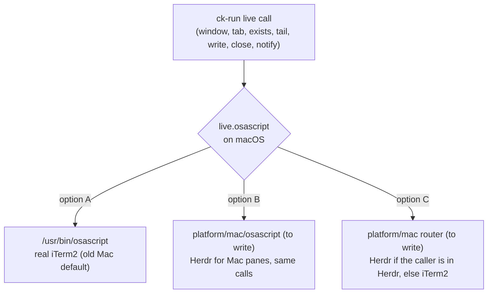

# platform/mac: ck-run's live host on macOS

> **DRAFT, UNVERIFIED: the Mac finishes this (`docs/MAC_HANDOFF.md`).**
> Written on the Windows PC from the old Mac line (`archive/ck-dispatch-2026-11-15/`). No file here was run on a
> Mac. This folder holds only this README until the Mac adds its launcher(s).

## What this folder is for

ck-run opens each live run in a terminal window. It talks to "iTerm2" through the program named in
`config/workspaces.json` → `live.osascript`, and keeps the machine awake with `live.caffeinate`.

| Host folder | Machine | Status |
|---|---|---|
| `platform/auto/` | Windows (WSL): router, Herdr OR tmux | built + used on the PC |
| `platform/herdr/` | Windows: Herdr app panes | built + used on the PC |
| `platform/wsl/` | Windows: tmux + Windows Terminal, toast, keep-awake stand-in | built, fallback on the PC |
| `platform/mac/` | macOS: iTerm2 and/or Herdr for Mac | **this draft** |

## Options for the Mac (the Mac picks one and tests it)

**A. iTerm2 only (smallest change).** Mac config: `live.osascript` = `/usr/bin/osascript`, `live.caffeinate` =
`/usr/bin/caffeinate`, `live.terminal` = `iTerm2`. No code here. This is how the old Mac line worked by default.

**B. Herdr for Mac through a stand-in.** Like `platform/herdr/osascript` on the PC: a script that answers ck-run's
iTerm2 calls with `hc` commands (`hc run`, `hc read`, `hc send`, `hc kill`). `ckdispatch/` stays unchanged. The PC
script uses `wsl.exe` and Windows paths, so it cannot be copied as is.

**C. A router**, like `platform/auto/osascript`, but without `/proc` (macOS has none; read the caller's env another
way, e.g. a value the shortcut exports, or `ps -E`; UNVERIFIED). Herdr caller → B; else → A.

**Old way (not in core):** the old Mac line had Herdr inside ck-run (`ckdispatch/herdr.py`, `CK_RUN_HOST`). Bringing
it back is a code change in `core/`; if the Mac does it, keep it OS-detected and list it in
`docs/CHANGES_FROM_MAC.md`.

## Facts from the old Mac line

| Thing | Old Mac line | Source |
|---|---|---|
| Default host | iTerm2, one window per ask, one tab per run; the session runs `<run>/live.sh` | `archive/ck-dispatch-2026-11-15/README.md` "Live mode" |
| osascript | `/usr/bin/osascript` | `archive/ck-dispatch-2026-11-15/config/workspaces.json` `live.osascript` |
| Keep awake | `/usr/bin/caffeinate -i -w <ck-run pid>` | `archive/.../ckdispatch/live.py` `CAFFEINATE`, `keep_awake()` |
| Host override | `CK_RUN_HOST=iterm` or `CK_RUN_HOST=herdr:<main terminal id>`; recorded as `export CK_RUN_HOST=...` in each launch `.sh` | `archive/.../ckdispatch/herdr.py` `detect_host()`, `archive/.../ckdispatch/launch.py` |
| Herdr tools | `hc`, `herdr-app` on the PATH or in `~/.local/bin`; overrides `CK_HERDR_HC`, `CK_HERDR_APP` | `archive/.../ckdispatch/herdr.py` `hc_path()`, `app_path()` |
| Herdr layout | main left half, agents stacked right, equal weights | `archive/.../README.md` "Live terminal host" |
| Pane states | `ck.state` = `done` / `needs` / `failed` (green / yellow / red) | same |
| Saved address | `live-host.json` in the run folder | same |
| Herdr test double | `tests/fake_herdr.py`, `tests/test_herdr.py` | `archive/.../tests/` |
| iTerm2 profiles | `~/Library/Application Support/iTerm2/DynamicProfiles/ck-run-live.json` | `archive/.../README.md` "Live mode" |

## Rules for what goes here

- Only Mac files. Windows behaviour must not change.
- Same calls and answers as the other hosts (window, tab, exists, tail, write, close, notify), so `ckdispatch/`
  does not need to know the host.
- A fake for the tests (like `tests/fake_osascript.py`), so the offline suite stays offline.
- `python3 -I tests/run_all.py` must still pass.
