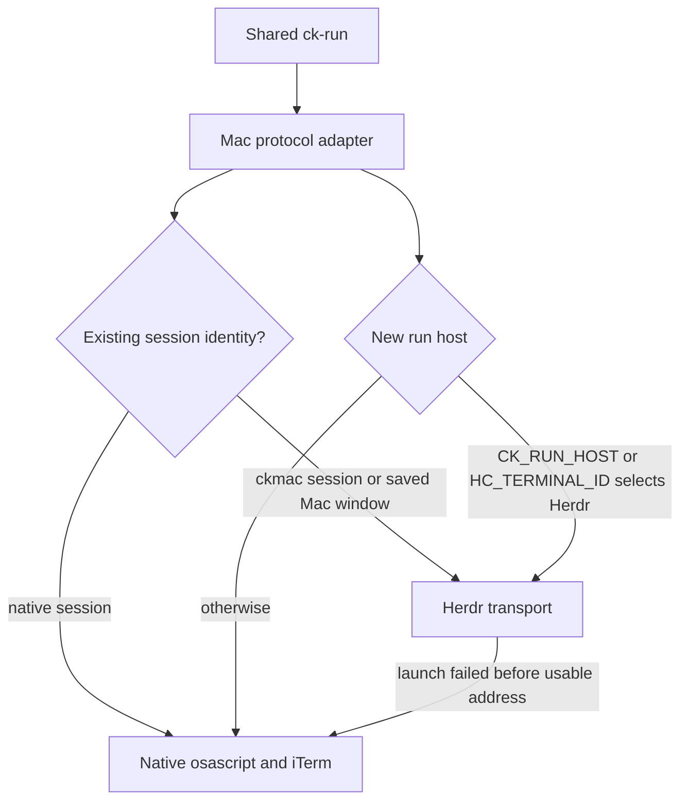

# Mac live host

The installer routes the Mac's `live.osascript` to `platform/mac/osascript`. It uses the shared runner's existing
AppleScript calls. Native iTerm receives the original arguments through `/usr/bin/osascript`. Herdr uses the live
Mac transport copied into `herdr.py`, with portable paths. Native caffeinate remains `/usr/bin/caffeinate`.



## Selection

| Caller | New run |
|---|---|
| `CK_RUN_HOST=iterm`, `iterm2` or `terminal` | Native AppleScript path |
| `CK_RUN_HOST=herdr:<terminal address>` | Herdr beside that main terminal |
| `CK_RUN_HOST=herdr` | Herdr beside `HC_TERMINAL_ID`, if present |
| No override, `HC_TERMINAL_ID` set | Herdr beside that terminal |
| No override and no Herdr identity | Native iTerm |

Invalid overrides stop with an error. The shared `live.terminal` setting stays `iTerm2` so its grouping, tail,
resume, notification and fallback protocol works. For Herdr this is a protocol label, not proof of an iTerm window.
The returned `how` field says `Herdr Mac`. Pane identities start with `ckmac-`; numeric grouping IDs are saved in
`~/.local/state/ck-osascript/mac/windows.json`. Follow-up reads, writes and close calls route by saved identity,
even from another host. No Linux `/proc`, WSL command or Windows binary is used.

## Live Mac behavior kept

- Resolve the main pane with `herdr-app ls`. Start beside it in the same tab. Keep main and unrelated panes on the
  left, stack its agents equally on the right. Layout updates check the document version and retry a conflict.
- If the main pane is absent, create or reuse the `CK` space and put the run in a new tab.
- Serialize launch and layout work under the runs folder lock. Keep the live Mac's launch spacing. Its default is
  defined by `LAUNCH_GAP_S` in `herdr.py`; override with `CK_HERDR_LAUNCH_GAP_S` only when diagnosing startup.
- Label the selected pane working at launch. A watcher reads the runner's final `result.json` and labels done,
  needs or failed. It leaves the original status in the result and ledger.
- Save the actual terminal address in each run's `live-host.json`. Write transport diagnostics to `herdr.log`.
- Once a clean result is final, use the live Mac delayed closer. It checks the later turn count and busy state.
  Partial or failed results stay open. The shared iTerm screen-based close request cannot kill a Herdr pane.
  `live.close_tab_after_s` controls the delay; nonpositive values disable automatic close.
- Only a terminal with `ck-run=true` can be removed by the live close helper. Do not stop the core server.

`hc` and `herdr-app` must be installed independently. Overrides: `CK_HERDR_HC`, `CK_HERDR_APP`. Setup creates the
native Cursor icon shell link rather than copying the source Mac binary. The agent receives its new pane's own
`HC_TERMINAL_ID`, so a nested launch is attached to the right caller.

A failure after a terminal starts leaves that terminal in place. A layout failure cannot start a duplicate agent.
The shared `live.claim` also protects a late terminal when the runner falls back to headless execution.

## Protocol and checks

`window`, `tab`, `exists`, `tail`, `write`, `close`, and `notify` have the same argument and reply shapes as the
shared iTerm scripts in `ckdispatch/live.py`. Notifications still use native macOS AppleScript.

```bash
python3 -I -m unittest discover -s core/ck-dispatch/platform/mac/tests
python3 -I core/ck-dispatch/tests/run_all.py
```

The Mac fixture starts no real app, core or agent. It checks routing, persistent identity, quoted paths, layout,
conflicts, failure fallback, labels and busy/follow-up close protection. Native UI permissions, visual placement,
real close timing, a live agent race and phone use remain **UNVERIFIED**. See [setup](../../../../setup/mac/README.md).
