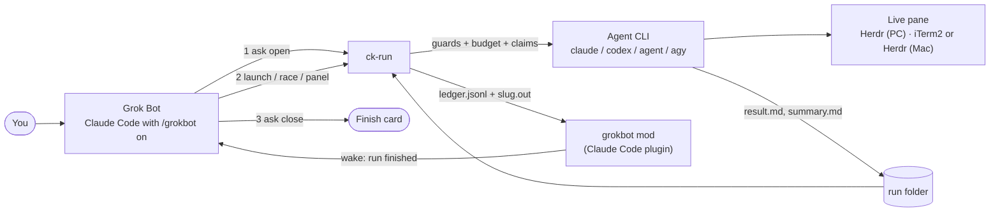
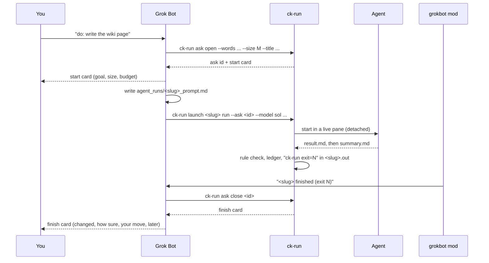
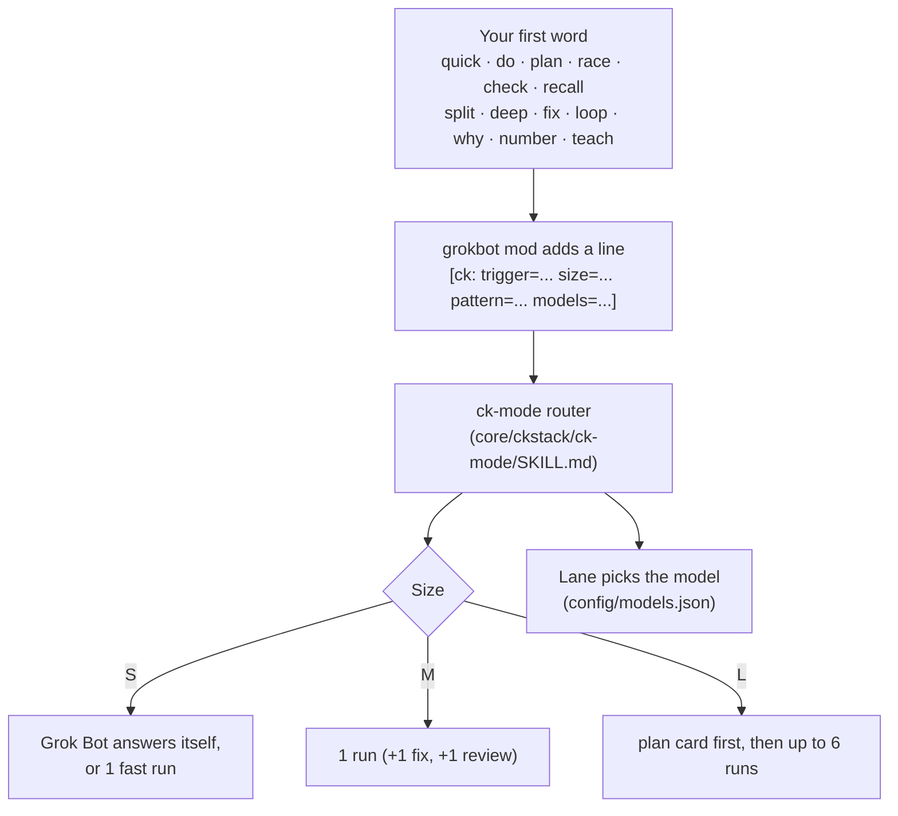
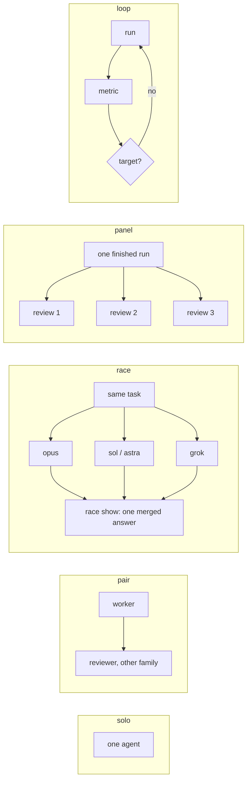
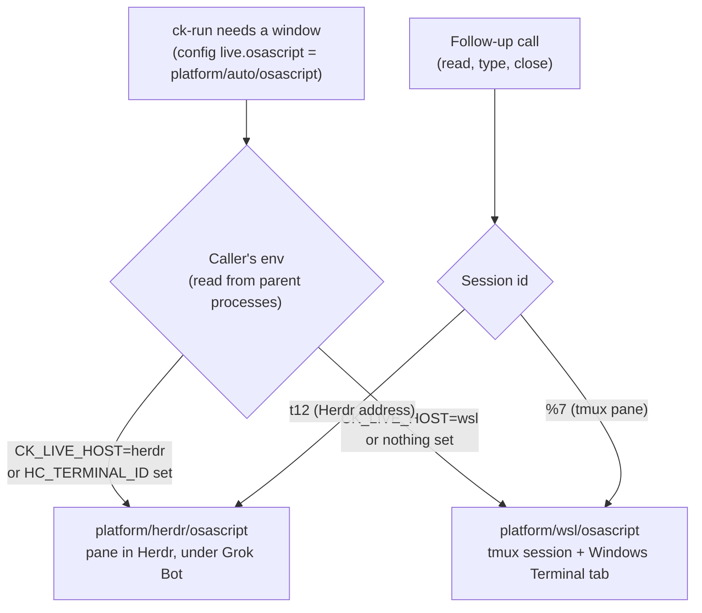
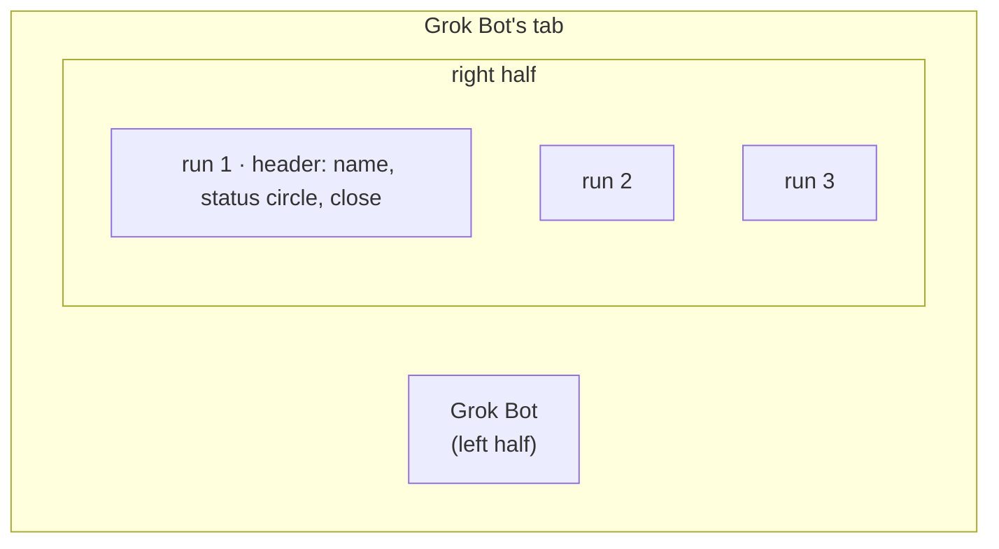
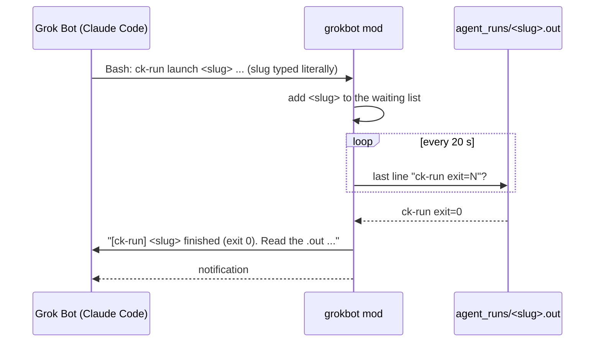
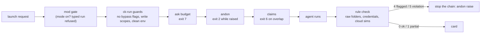
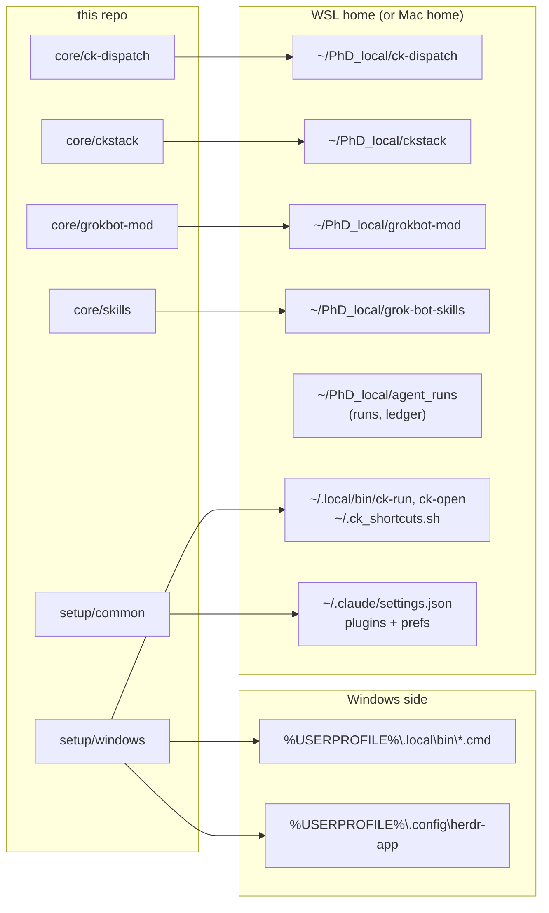

# Architecture

One diagram per idea. Each diagram has a few lines of plain text under it.
Sources: `core/ck-dispatch/docs/v4.md`, `core/grokbot-mod/GROKBOT.md`, `core/ckstack/ck-mode/SKILL.md`,
`core/ck-dispatch/platform/*/README.md`, `core/ck-dispatch/platform/auto/osascript`.

## 1. The whole chain

- **Grok Bot** is the orchestrator. Today it is Claude Code with the `/grokbot` mode on (a stand-in for the real
  Grok Bot). It does not do heavy work itself. It routes.
- **ck-run** (`~/PhD_local/ck-dispatch/bin/ck-run`) is the only way to start an agent. It checks guards, the ask's
  budget and path claims, builds the agent's command, and writes everything to the ledger.
- **Agents** are the CLIs, each signed in by you: `claude`, `codex`, cursor `agent`, `agy`.
- **Panes**: each run is visible in its own live terminal pane.
- **The mod** watches launches of this session and wakes Grok Bot once when they end.

## 2. One ask, start to finish

- An **ask** is one request from you. Every run, review and fix carries its ask id (`A-MMDD-N`).
- You see one **start card** and one **finish card** per ask. No per-run reports.
- A run is started **detached** (`ck-run launch`), so it keeps going if Claude restarts.

## 3. Words to size, pattern and models

- The size sets a **budget** that ck-run counts (runs, live at once, reviews, fixes, minutes). Over budget = exit 7.
- The **lane** picks who works and who checks, for example `writing`: opus works, sol checks.
- Full tables: [`HOW_TO_USE.md`](HOW_TO_USE.md).

## 4. Patterns

- **solo**: one agent. **pair**: one agent, then one review by another agent.
- **race**: the same task to 2 or 3 models at once. Grok Bot merges ONE answer and shows where they disagree.
- **split**: parts of a job to different agents at the same time. **panel**: 2 or 3 reviews of one run.
- **loop**: improve one number step by step with a cheap local metric. Never a cloud simulation.

## 5. Where the panes open (Windows PC)

- ck-run was built on the Mac. It talks to "iTerm2" through a program named `osascript`. On the PC that program is a
  stand-in script, so `ckdispatch/` needs no change.
- The router sends a new window to **where the caller runs**: Herdr or WSL, never both.
- ck-run cleans the environment of its children, so the router reads the env of its **parent** processes.
- Herdr sets `HC_TERMINAL_ID` in every Herdr terminal. The `.cmd` shortcuts forward it into WSL (`WSLENV`).
- Follow-ups go to the side that owns the run. Herdr window ids start at 5000; tmux ones are below.

## 6. Herdr layout (Windows PC)

- Each run under a Grok Bot is a Herdr **sub-agent** (`hc run --parent`) and a pane in Grok Bot's tab.
- First run: right of Grok Bot (half the width). Next runs: stacked below on the right (3 runs = 1/2, 1/4, 1/4).
- Circle colors (layout `main-ck`, mod `agents-ck`): **green** = done, **yellow** = needs you, **red** = failed.
- A clean finished pane closes itself after `live.close_tab_after_s` (300 s in `core/ck-dispatch/config/workspaces.json`).
  A pane with a problem stays.
- When a run writes `result.json`, its pane sends Herdr a "done" or "error" state, so the Agents list updates at once.
- Herdr runs live in herdr-core (`hc.exe`), so they keep going when the Herdr window closes.

## 7. Wake: how Grok Bot knows a run ended

- The mod finds launches by **reading the command text**. So type the ask id and slug literally (never `$A`).
- A race or panel wakes Grok Bot early for each run that ends, then once more when the last one ends.
- With the mode off: a notification and a log line, but no wake.

## 8. Safety layers

- The agent gets a clean environment: no keys or tokens.
- Each agent runs in its own safety-reviewed auto mode; ck-run adds the flags. Nobody else may pass them.
- Raw data folders and rule files are protected (per workspace, in `config/workspaces.json`).
- Exit codes: 0 ok · 1 partial · 2 refused · 3 failed/timeout/stalled · 4 flagged · 5 violation · 6 busy · 7 over budget.

## 9. Install layout

- Setup **copies** `core/` and fills placeholders (`{{PHD_ROOT}}`, `{{WIN_USER}}`, ...). The repo stays clean.
- `agent_runs/` (ledger, run folders, locks) stays local, off OneDrive.
- `archive/` is never installed.

## 10. Files ck-run keeps

| Path (under `~/PhD_local/agent_runs/`) | What |
|---|---|
| `ledger.jsonl` | every event: asks, launches, results, stalls, andon |
| `<run id>/` | one run: packet, prompt, result.md / result.json, summary.md |
| `<slug>.sh`, `<slug>.out`, `<slug>_prompt.md` | a launch: its script, its output (last line `ck-run exit=N`), its task |
| `.windows/<ask id>.json` | the live window of an ask |
| `.andon/<name>.json` | a raised andon |
| `.claims/` | live runs and the paths they claim |
| `grokbot_standin_log.md` | the mod's launch log |
