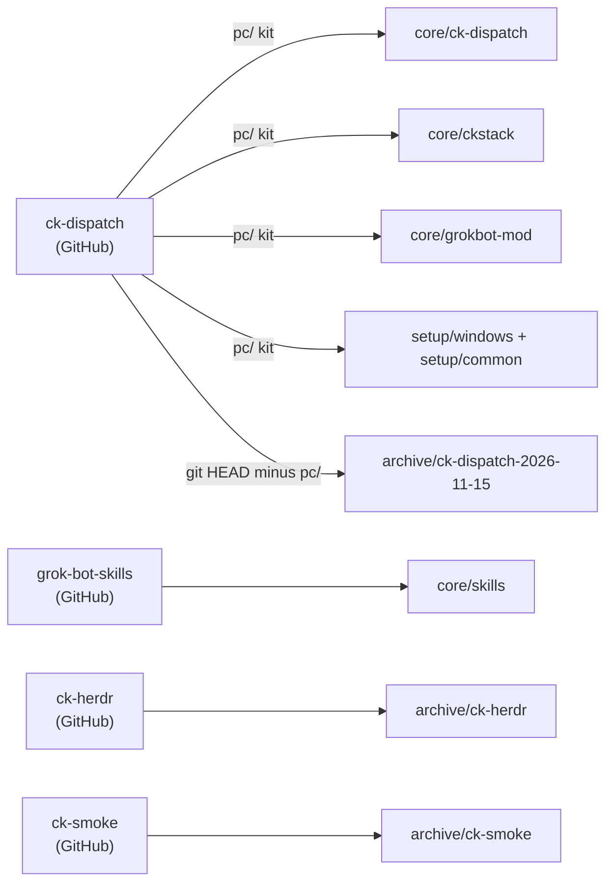

# History: where the 4 old repos went

Before 2026-11-15 the framework lived in 4 separate GitHub repos (all under `{{GITHUB_USER}}`). This repo replaces
them. Source of this page: the build's import list (`verification/import-manifest.json`, local only) and the plan
(ask A-1115-21).

## Old repo → new place

| Old repo | What it had | New place | Notes |
|---|---|---|---|
| `ck-dispatch` | ck-run (Mac line at its top level) and the `pc/` kit: the PC's ck-dispatch, ckstack, grokbot-mod, Windows setup | `core/ck-dispatch/` (from `pc/ck-dispatch`), `core/ckstack/`, `core/grokbot-mod/`, `setup/windows/`, `setup/common/` | The PC line is the live one. It keeps `platform/{auto,herdr,wsl}`. |
| `ck-dispatch` (top level, git HEAD) | the old Mac line: `ckdispatch/herdr.py`, `CK_RUN_HOST`, iTerm2 config, `docs/framework_v3`, `docs/step3`, `tests/test_herdr.py`, `tests/fake_herdr.py`, `tests/test_pathflag.py` | `archive/ck-dispatch-2026-11-15/` | History only, never installed. The owner: "not the most refined version". The Mac part is rebuilt from the Mac's live files (`docs/MAC_HANDOFF.md`). |
| `grok-bot-skills` | all lab domain skills, agent prompt skills, `ck-delegate`, `phd-wiki-rules` | `core/skills/` | Installed to `~/PhD_local/grok-bot-skills` (same path as before, so old references still work). Setup copies it; no second clone. |
| `ck-herdr` | v2 Herdr launcher prototype and research | `archive/ck-herdr/` | Superseded by `core/ck-dispatch/platform/herdr/`. |
| `ck-smoke` | output lines from smoke races | `archive/ck-smoke/` | History of smoke tests (opus, sol, grok, 2026-11-15). |

`ckstack` and `grokbot-mod` were not separate GitHub repos here: they came from the `pc/` kit inside `ck-dispatch`
(on the source PC they also lived as folders under `~/PhD_local`).

## What was left out on purpose

From the build's strip rules: run logs and artifacts, progress and summary records, backup configs, a live-run
example, caches and temporary files. Also never included: agent logins and tokens, Claude memory files (they hold
device names), chat history, ledgers, Herdr window state, lab project folders.

User names, Tailscale names and IPs, and emails in the old files were replaced with placeholders (also in
`archive/`). List: `setup/common/placeholders.json`.

## Are the old repos archived on GitHub?

**Not yet (as of 2026-11-15).** The plan does it last, and only with the owner's OK (plan step 6):

1. This repo is pushed to GitHub (plan step 5).
2. The owner says OK.
3. Each old repo is set to **Archived** on GitHub (Settings → Archive this repository). Archived = read only. It is
   **never deleted**. Its history stays.
4. This PC switches to run from the new repo.

When step 3 is done, change this section to "Archived on <date>". Until then, treat the old repos as frozen: make new
changes here, not there.

## Timeline

| Date | Event |
|---|---|
| 2026-11-02 | ck-run step 1 on the Mac (offline, stub CLIs); live iTerm2 mode |
| 2026-11-04 | `/grokbot` mod: Claude Code as the Grok Bot stand-in |
| 2026-11-05 | ck-run v4: asks, sizes, budgets, lanes, launch, watchdog, views, race, panel, loop |
| 2026-11-15 | ck-run on the Windows PC in WSL (tmux + Windows Terminal stand-in) |
| 2026-11-16 (dates in the Herdr README) | Herdr app as the live host; router "Herdr OR terminal"; panes stacked right of Grok Bot |
| 2026-11-15 | this repo built (ask A-1115-21): PC part tested locally; Mac part handed to the Mac |

Dates come from the READMEs in `core/`. The Herdr notes say 2026-11-16, one day after this repo's build date
(2026-11-15). They are kept as written; which date is right is UNVERIFIED.
