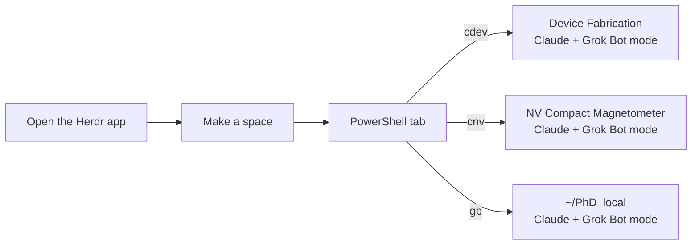
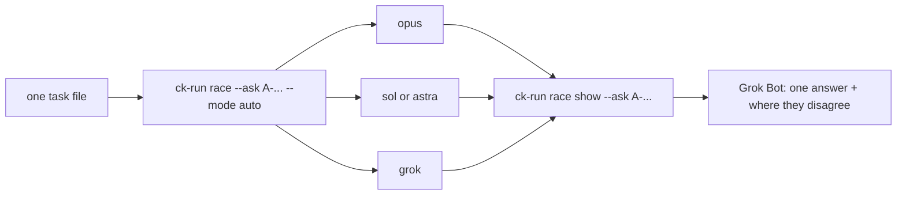

# How to use it

Plain guide for daily work. The full command guide is `core/ck-dispatch/docs/v4.md`.
Below, `ck-run` = `~/PhD_local/ck-dispatch/bin/ck-run` (also on the PATH as `~/.local/bin/ck-run`).

## 1. Daily start

### Windows PC



| Type (PowerShell) | What happens |
|---|---|
| `cdev` | goes to Device Fabrication in WSL and starts Claude Code with Grok Bot mode on |
| `cnv` | the same for NV Compact Magnetometer |
| `gb` | the same for `~/PhD_local` |
| `phd` | only goes to `~/PhD_local` in WSL (no Claude) |
| `gbh`, `cdevh`, `cnvh` | starts a Grok Bot for that folder in the Herdr space "Grok Bot" for you. Already running: it is shown, not started twice |
| `gbh --continue` | the last conversation, moved into Herdr. `gbh --resume <id>` for another one |

- The shortcuts set `CK_GROKBOT_AUTO=1`, so the grokbot mod turns Grok Bot mode on by itself.
- Inside WSL the same names are shell functions (`~/.ck_shortcuts.sh`): `cdev`, `cnv`, `gb`, `phd`.
- Agents you start then open as panes on the right half of Grok Bot's tab.

### Mac

UNVERIFIED until the Mac part is merged. The Mac had the same idea: zsh shortcuts `cdev`, `cnv`, `gb`, live runs as
iTerm2 tabs or Herdr panes. See `setup/mac/README.md`.

## 2. Grok Bot mode

| Type in Claude Code | What it does |
|---|---|
| `/grokbot` | turns the mode on (the shortcuts do it for you) |
| `/grokbot <task>` | turns it on and sends the task |
| `/grokbot off` | turns it off. Live runs keep going |
| `/grokbot status` | mode, paths, launches still running |
| `/grokbot board` | what needs you, what runs, what was done today |
| `/grokbot today` | today per project |
| `/grokbot recall <project>` | catch up on one project |
| `/grokbot rules` | what each agent may do now |
| `/grokbot models` | model aliases, tiers, lanes |

`/clear`, `/resume`, `/branch` and a new session end the mode. Type `/grokbot` again.
Then ask Grok Bot to check `ck-run board` and run `ck-run reattach` (it finishes runs whose watcher died).

## 3. Trigger words

Start your message with a trigger word, then `:` and the task. Example: `race: why is the coupling stuck at 5%?`

| Word | Size | Pattern | What happens |
|---|---|---|---|
| `quick` | S | solo | Grok Bot answers itself, no review |
| `do` | M | solo | one agent in the right lane |
| `plan` | L | from the plan | a plan card first; work starts after your OK |
| `race` | Grok Bot picks | race | astra + opus + grok on the same task, one merged answer |
| `check` | Grok Bot picks | pair | one agent, then one review |
| `recall` | S | answer | catch up on a project |
| `split` | L | split | parts to different agents at once |
| `deep` | Grok Bot picks | panel | 2 or 3 reviews |
| `fix` | M | solo | bug-fix playbook |
| `loop` | L | loop | improve one number step by step |
| `why` | S | solo | research scout |
| `number` | S | solo | check one number and its source |
| `teach` | S | solo | explain a topic |

- Model words name the models: `sol astra opus sonnet haiku grok composer gemini`.
- Size words: `S`, `M`, `L` (capitals only). Your words win: "quick", "short", "for now", "no review" = S.
  "check it", "careful" = add one review. "all 3 agents" = 3 at once.
- No trigger word: Grok Bot picks and says so on the start card.

## 4. Asks and cards

Each request is one **ask**. You get two cards:

**Start card** (at most 4 lines): the ask id, the goal in Grok Bot's words, size, pattern, models, budget.
Read the goal line. If it is wrong, say so now, before any agent starts.

**Finish card** (at most 8 lines):

```
<ask>  <title>   DONE   <runs>, <time>
Changed: <what changed, at most 3 lines>
How sure: hardware test | local sim you ran | fake data or tests | desk check | not checked
You should know: <at most 2 lines>
Your move: <what you do next, or "nothing">
Later (N): <ideas not done, numbered>
```

- "How sure" is the **lowest** level of all runs in the ask.
- "Later" items are ideas NOT done. Nobody works on them until you say so. Say "yes 2" to start item 2 as a new ask.

## 5. Budgets

ck-run counts these per ask (`core/ck-dispatch/config/workspaces.json`, block `asks.budgets`):

| | S | M | L |
|---|---|---|---|
| agent runs | 1 | 2 | 6 |
| live at once | 1 | 1 | 3 |
| reviews | 0 (1 if you asked) | 1 | 2 |
| fix runs | 0 | 1 | 2 |
| wall time | 15 min | 45 min | 180 min |
| timeout per run | 600 s | 1800 s | 7200 s |
| stall alarm | 180 s | 300 s | 480 s |

- Over budget: **exit 7**, nothing starts. Grok Bot tells you the limit in one line and asks.
- To go over once, Grok Bot reruns the command with `--over "<your exact words>"`. It never uses its own words.
- Out of wall time: the ask is parked. Grok Bot closes it with what is done (`--done partial`).
- A race sets its own budget: one run per race model, all at once.
- An L plan file can set its own budget with a line like `budget: runs=6 parallel=3 reviews=2 fixes=2 wall_min=180`.

## 6. Models and lanes

`ck-run models` prints the truth (`core/ck-dispatch/config/models.json`). Lanes say who works and who checks:

| Lane | Worker | Also good | Check |
|---|---|---|---|
| quick | Grok Bot itself | sonnet, composer | none |
| lab-code | sol | astra, grok | opus |
| bug-fix | sol | astra | opus |
| numbers | sol | opus, grok | opus |
| wiki | sol | composer, gemini | sonnet |
| writing | opus | astra, grok | sol |
| decision | race | | none |
| loop | sol-fast | composer, sonnet | astra |
| repo | sol | astra | opus |
| scout | grok | sol | opus |
| mechanical | composer | gemini | none |

- Claude models (opus, sonnet, haiku) edit only `~/PhD_local`. For an edit inside a OneDrive workspace, Grok Bot
  picks a non-Claude model, or Opus writes a draft in `~/PhD_local`.
- A check is always by another agent than the worker.

## 7. Races: always `--mode auto`



- `ck-run race` uses `--mode read` by default. In read mode the agents stop and wait for approval to write their
  result files. So **always pass `--mode auto`** to a race.
- After the race: `ck-run race show --ask <id>` puts the answers side by side. Grok Bot writes ONE answer.

## 8. Reviews

A review needs a reason (`--trigger`). No reason, no review.

| Reason | When |
|---|---|
| `leaves-lab` | numbers or claims go into slides, a paper, a patent, VC or AQS material, an email, a purchase |
| `hardware-or-raw` | code that drives lab hardware, or touches raw data |
| `agent-unsure` | the result is partial or not checked, or a guess on a choice that matters |
| `you-asked` | you said "check it", "review" or "deep" |

- One reviewer, verdict first, at most 3 findings, each with proof.
- No automatic review after cursor or agy runs (your decision, 2026-11-05). The rule check still runs on every run.

## 9. Andon: stop the line

Exit 4 (flagged) or 5 (violation) stops the chain:

```bash
ck-run andon raise --project <name> --reason "<the error line>"
ck-run andon list
ck-run andon clear --project <name> --note "<your words>"
```

- While raised, every new run in that project is refused (exit 2).
- Only **your words** clear it. Grok Bot never clears it by itself.

## 10. Board and views

| Command | What you get |
|---|---|
| `ck-run board` | NEEDS YOU, RUNNING, DONE TODAY |
| `ck-run board --md` | the same as Markdown in `~/PhD_local/BOARD.md` |
| `ck-run digest --since 7d` | per project: asks, runs, agent minutes (good for a PI meeting) |
| `ck-run recall <project>` | 5 lines on a project, then its asks |
| `ck-run scoreboard` | per lane and model: runs, ok rate, minutes |
| `ck-run rules` | what each agent may do, and your decisions |

## 11. Lessons learned (follow them)

1. **Race needs `--mode auto`.** Read mode stalls agents on write approval.
2. **Type ask ids literally** in ck-run commands (`--ask A-1115-21`, never `--ask $A`). The mod finds launches by
   reading the command text.
3. **A write scope inside `~/PhD_local` must already exist and be its own git repo**, or ck-run refuses (exit 2).
4. **Exit 4 or 5 stops the chain**: `ck-run andon raise`. Only your words clear it.
5. **Codex trust warning**: in a new folder Codex may show a one-time "folder settings can run code" warning. It is
   not a blocker.
6. **Herdr OR terminal, never both**: inside Herdr, runs open as Herdr panes; in a plain WSL terminal, in tmux +
   Windows Terminal.
7. **An old Claude session** (started before Herdr set `HC_TERMINAL_ID`) sends runs to WSL. Fix in that session:
   `export CK_LIVE_HOST=herdr CK_HERDR_PARENT=<hc address>`, or start a fresh one with `gbh`.
8. **Never run `hc server stop` or `hc server restart`.** It kills every terminal. Herdr help: `hc.exe --skill`, and
   `AGENTS.md` in the Herdr config folder.
9. **Do not type into agent panes.** ck-run sends `continue` once after sleep, and stops a silent run at twice its
   stall time (exit 3).
10. **Smoke test**: say `quick smoke test of the 3 agents`. Codex does not show its model name (UNKNOWN is fine). In
    Device Fabrication, Claude runs end "partial" because of the wiki-first rule. That is expected.

## 12. Exit codes

| exit | means | what to do |
|---|---|---|
| 0 | ok | read the card |
| 1 | partial | read what is missing |
| 2 | refused | fix the command; never loosen flags |
| 3 | failed, timeout, stalled | look at the pane and the `.out` |
| 4 | flagged | andon raise; you decide |
| 5 | violation | andon raise; you decide |
| 6 | busy (another run claims the path) | wait, or use other paths |
| 7 | over budget | say "go" with your words, or stop |
