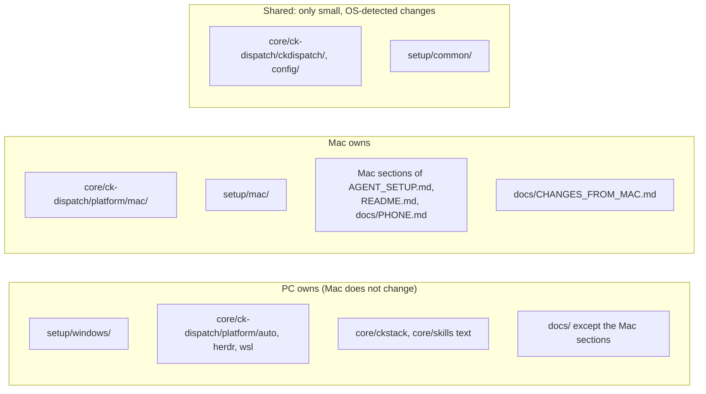

# Mac handoff

The Windows PC built the shared core and the Windows setup. The **Mac's Claude** adds the Mac part, tests it on
the Mac, and opens a pull request. This page is the contract, plus a copy of the prompt the owner pastes on the Mac.

## 1. The contract: who owns what



| Area | Rule |
|---|---|
| `core/ck-dispatch/platform/mac/` | Mac owns. The Mac live-host launcher(s) ck-run calls (iTerm2 and/or Herdr on Mac), plus its README. |
| `setup/mac/` | Mac owns. `setup.sh` (idempotent; `--dry-run` prints every action and changes nothing), README. |
| Mac sections of `AGENT_SETUP.md` (section M), `README.md` ("New Mac"), `docs/PHONE.md` (Mac side) | Mac owns. Replace the UNVERIFIED drafts. |
| `docs/CHANGES_FROM_MAC.md` | Mac creates it. Lists every change outside the Mac folders, with the reason. |
| `core/ck-dispatch/ckdispatch/`, `config/`, `setup/common/` | Change only if the Mac needs it. Keep it small and OS-detected. Windows behaviour must not change. List it in `docs/CHANGES_FROM_MAC.md`. |
| `setup/windows/`, `platform/{auto,herdr,wsl}`, shared skills and ckstack text | Do not change, unless a fix is needed for both; then list it. |
| `archive/` | Read only. Its Mac line is older and "not the most refined version" (the owner). Use the Mac's live files. |
| Git | Branch `mac-part`. Push the branch, open a PR to `main`. **Never** merge, push to `main`, force-push or delete on GitHub. |

**Done means** (Mac side): `bash setup/mac/setup.sh --dry-run` lists every action; an install into a temp HOME and
a repeat install work; `ck-run models` and `ck-run --help` work from that install;
`python3 -I core/ck-dispatch/tests/run_all.py` still passes (Windows tests included); privacy grep clean; with the
owner's OK, a live 3-agent smoke test on the Mac.

## 2. What the PC side knows that the Mac will need

From reading the PC files (desk check, not tested on a Mac):

- `core/ck-dispatch/config/workspaces.json` is the **PC** config: `live.osascript` = `platform/auto/osascript`
  (a router that reads `/proc`: Linux only), `live.caffeinate` = the WSL stand-in, and `bin_dirs` without
  `/opt/homebrew/bin`. The Mac needs its own values: for iTerm2, `live.osascript` = `/usr/bin/osascript`,
  `live.caffeinate` = `/usr/bin/caffeinate`, and `/opt/homebrew/bin` in `bin_dirs` (the old Mac config had these:
  `archive/ck-dispatch-2026-11-15/config/workspaces.json`).
- `core/ck-dispatch/ckdispatch/` has **no** `herdr.py`. The old Mac line had Herdr on the Mac inside ck-run
  (`archive/ck-dispatch-2026-11-15/ckdispatch/herdr.py`, `CK_RUN_HOST`). The PC does Herdr outside ck-run, through
  the `osascript` stand-in scripts. Pick one way for the Mac and say which in `docs/CHANGES_FROM_MAC.md`.
- `setup/windows/setup_support.py` holds the reusable install logic: copy `core/` with placeholders, the `ck-run`
  link, the shortcut file, the plugin lines, the settings merge with `.bak`, dry run. Reuse it where you can.
- The shortcuts (`setup/windows/wsl/ck_shortcuts.sh`) are bash. The Mac uses zsh (`~/.zshrc`).
- `setup/common/placeholders.json` already lists `MAC_HOME` and `MAC_USER` as reserved for the Mac worker.
- The PC tests passed on the PC build (402 tests, `verification/offline-suite-final.log`, local only).

## 3. Privacy check (Mac side)

Use the privacy grep from the handoff prompt the owner gives you. Its real pattern holds the private names, so it is
**not** copied here. The shape, with placeholders:

```bash
grep -rIEn '({{LAST_NAME}}|{{SHORT_NAME}}\b|100\.[0-9]+\.[0-9]+\.[0-9]+|{{INSTITUTION}}|BEGIN .*PRIVATE|sk-[A-Za-z0-9]{20}|[g]ho_|[g]hp_)' --exclude-dir=.git .
```

It must find nothing outside placeholder lists. Known allowed hit: `100.64.0.0/10` in `docs/PHONE.md` (the public
Tailscale range).

## 4. The prompt the owner pastes on the Mac (copy)

Sanitized copy: the GitHub user is `{{GITHUB_USER}}`, the owner's name is "the owner", and the privacy pattern is
shown as placeholders. The original lives outside the repo (CK's run folder) and is the one to paste.

> You are helping the owner unify their AI agent framework (ck-run, Grok Bot mode, ckstack, skills, Herdr) into ONE
> private GitHub repo: `https://github.com/{{GITHUB_USER}}/ck-agentic-framework`. The Windows PC builds the shared
> core and the Windows setup. YOUR job on this Mac: add the Mac part, so a brand-new Mac can clone the repo and get
> this Mac's exact setup. The owner's words: "both mac and window pc part. very detailed ... when i have a new mac or
> window PC i can just clone it and have the local agent implement right away. like everything here including even
> phone ck herdr method". Write for the owner in short plain English (English is their second language).
>
> **0. Wait for the PC part.** Run: `gh repo clone {{GITHUB_USER}}/ck-agentic-framework ~/ck-agentic-framework`
> (or `git pull` if it exists). If `core/` is missing on `main`, the PC part is not pushed yet. Do step 1 only, save
> notes in `~/ck-mac-staging/`, and tell the owner "PC part not pushed yet". Continue from step 2 when `core/` exists.
>
> **1. Inventory this Mac (read only, change nothing).** Find and list, with paths, everything that makes the
> framework run here:
> - this Mac's live ck-dispatch (ck-run): its folder, `git log -5`, and how it differs from the repo's
>   `core/ck-dispatch` (`diff -r`, ignore `__pycache__`, run outputs, ledgers). The Mac version is the truth for
>   Mac-only parts. NOTE: the repo's `archive/ck-dispatch-2026-11-15/` holds an OLDER Mac line (`ckdispatch/herdr.py`,
>   `CK_RUN_HOST=iterm|herdr`). The owner says it "is not the most refined version". Use this Mac's current files instead.
> - live host on Mac: iTerm2 (osascript), Herdr for Mac (layout, mods, settings, keys, themes), caffeinate.
> - shell shortcuts (zsh: cdev, cnv, gb, grokbot or similar), PATH lines, the agent CLIs and how they were installed
>   (claude, codex, cursor `agent`, agy), Claude plugins and marketplaces (`~/.claude/settings.json` enabledPlugins,
>   extraKnownMarketplaces, theme, modelSettings), plugin store prefs, grokbot-mod and ckstack locations.
> - phone and remote: Herdr mobile, Tailscale, SSH between Mac and PC (Herdr "machines"). Note the method only.
>
> **2. Build the Mac part (branch `mac-part`).** Put Mac-only things only here:
> - `core/ck-dispatch/platform/mac/`: the Mac live-host launcher(s) ck-run calls (iTerm2 and Herdr on Mac), plus
>   README. `config/workspaces.json` must route to it on macOS. If that needs a code change in `core/`, keep it small,
>   make it OS-detected (Windows behaviour unchanged), and list it in `docs/CHANGES_FROM_MAC.md`.
> - `setup/mac/setup.sh`: idempotent, `--dry-run` prints every action and changes nothing. It asks for or accepts
>   MAC_USER and PHD_ROOT, installs core/ into `~/PhD_local` like the Windows setup does, the zsh shortcuts, Herdr Mac
>   files (copy only if absent, else keep a `.bak`), Claude plugins from `setup/common/`, then runs the smoke check
>   `setup/common/smoke.sh`. Reuse `setup/common/` and the Windows `setup_support.py` logic where you can.
> - `setup/mac/README.md` and the Mac sections of `AGENT_SETUP.md`, `README.md`, `docs/PHONE.md` (Mac side: Herdr
>   machine to the PC, Tailscale; method only). Very detailed, step by step, plain English.
>
> Do NOT change Windows files (`setup/windows/`, `platform/{auto,herdr,wsl}`) or the shared skills/ckstack text unless
> a fix is needed for both; then list it in `docs/CHANGES_FROM_MAC.md`.
>
> **3. Privacy** (the repo is private but must stay clean enough to go public). No keys, tokens, passwords, emails, IP
> addresses, Tailscale device names, SSH key contents, or user names (use placeholders like `{{MAC_USER}}`,
> `{{PHD_ROOT}}`, `{{TAILSCALE_PC}}`). Check with the privacy grep (section 3 above; the real pattern is in the
> original prompt). It must find nothing outside placeholder lists.
>
> **4. Check, then push the branch.**
> - `bash setup/mac/setup.sh --dry-run`; an install into a temp HOME (`HOME=$(mktemp -d) bash setup/mac/setup.sh --yes ...`)
>   and a repeat install; `ck-run models` and `ck-run --help` from that install;
>   `python3 -I core/ck-dispatch/tests/run_all.py` (must still pass; Windows tests included).
> - If the owner agrees: a live smoke test on this Mac (opus, sol, grok, `--mode auto`) in Herdr or iTerm2.
> - Commit on `mac-part`, push the branch, open a pull request to `main` with `gh pr create`. In the PR text say: what
>   you added, what you checked (with results), what is UNVERIFIED. Do NOT merge. The owner (or the PC's Grok Bot)
>   reviews and merges.
> - Never push to `main`, never force-push, never delete anything on GitHub.
>
> **5. Report to the owner.** One short card: what you added, how sure (dry run / temp install / tests / live smoke),
> what they must do next, and open questions numbered at the end.

## 5. After the PR

The PC's Grok Bot (or the owner) reviews the PR against section 1. Merge only with the owner's OK. Then remove the
"UNVERIFIED" marks the Mac has proven, and keep the rest.
