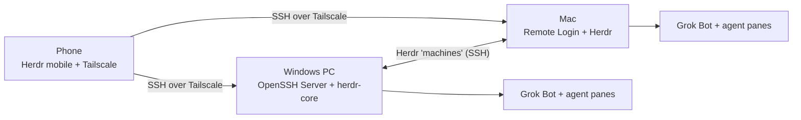

# Phone: Herdr mobile over Tailscale SSH

Use the agents from your phone. The Herdr mobile app connects over **SSH** to the PC (and the Mac). The SSH
connection goes through **Tailscale**, a private network between your own devices. Nothing is open to the internet.

This page is the **method only**. It has no real names, users or addresses. Use your own values where you see:

| Placeholder | Means |
|---|---|
| `{{TAILSCALE_PC}}` | the PC's Tailscale device name (Tailscale app → Machines) |
| `{{TAILSCALE_MAC}}` | the Mac's Tailscale device name |
| `{{WIN_USER}}` | your Windows user name |
| `{{MAC_USER}}` | your Mac user name |

Never write the real values into this repo.



How sure: the PC side was set up and used on the source PC (owner's notes, 2026-11-15). The `hc machine add`
syntax was read from `hc.exe machine add --help` on the source PC and from Mac `hc machine add --help` in the
Mac inventory. This is the method only. Phone menus, inbound Mac SSH, and an end-to-end connection remain
**UNVERIFIED**. For more, run `hc.exe --skill` (PC) or `hc --help` (Mac).

## 1. PC side (Windows)

1. **Tailscale**: install the Tailscale app for Windows and sign in. Check: the app shows the PC as connected.
2. **OpenSSH Server**, in an **admin PowerShell** (standard Windows commands):

   ```powershell
   Add-WindowsCapability -Online -Name OpenSSH.Server~~~~0.0.1.0
   Set-Service -Name sshd -StartupType Automatic
   Start-Service sshd
   ```

   Check: `Get-Service sshd` shows `Running`.
3. **Firewall: SSH only from Tailscale.** Allow port 22 only from the Tailscale range `100.64.0.0/10` (this range
   is public knowledge, the same for every Tailscale user):

   ```powershell
   New-NetFirewallRule -Name sshd-tailscale -DisplayName "OpenSSH (Tailscale only)" -Direction Inbound -Protocol TCP -LocalPort 22 -RemoteAddress 100.64.0.0/10 -Action Allow
   ```

   If Windows already made a rule named `OpenSSH-Server-In-TCP` that allows any address, limit or disable it:
   `Set-NetFirewallRule -Name OpenSSH-Server-In-TCP -RemoteAddress 100.64.0.0/10`.
4. **Keys (better than a password)**: put the phone's public key (and the Mac's) in the Windows user's
   `.ssh\authorized_keys`. For an admin account, Windows reads `C:\ProgramData\ssh\administrators_authorized_keys`
   instead. Never copy a private key into this repo.
5. **Herdr** must be running on the PC (herdr-core keeps terminals alive when the window is closed).

## 2. Mac side

Do this on the destination Mac. The framework installer does not enable SSH or change network settings.

1. Install the Tailscale app and sign in to the same private network as the PC and phone. The source Mac used the
   App Store app. Get your destination machine's value for `{{TAILSCALE_MAC}}` from Tailscale itself. Keep it local.
2. Install Herdr for Mac and open it once. Check `command -v hc` and `command -v herdr-app`. Install the framework
   using `setup/mac/README.md`, then choose the `ck-main` layout. Leave the core server running.
3. **macOS Remote Login must be ON for phone or other inbound SSH access.** Open System Settings → General →
   Sharing → Remote Login and turn it on. Allow only your user. The owner does this; framework setup does not.
   Confirm it is actually listening with `lsof -nP -iTCP:ssh -sTCP:LISTEN`. A launchd enabled flag alone
   does not prove a listening SSH service. A fresh Mac connection remains UNVERIFIED until you test it.
4. Add the phone's public key to your Mac user's `~/.ssh/authorized_keys` using your normal local SSH setup.
   Keep the private key on its original device. Do not paste either key into this repo or an agent prompt.
5. Use the Tailscale name as the phone's destination. Do not forward a router port. Remote Login can also listen
   on other Mac interfaces; Tailscale being installed does not restrict that by itself. Check your local firewall
   policy before relying on a Tailscale-only connection.
6. Keep the Mac awake and reachable while using it remotely. Native caffeinate prevents idle sleep while ck-run
   waits for a live run; it does not prove the Mac remains reachable with the lid closed.
7. In the phone's Herdr app, add `{{MAC_USER}}@{{TAILSCALE_MAC}}` with your local SSH key, then open a terminal.
   Check that you can see the intended spaces and safely type a harmless command before starting lab work.
8. To let this Mac show the PC in desktop Herdr, use the method in the next section. Machine records are private
   state; the installer does not import them from the source Mac.

## 3. Phone side

1. Install **Tailscale** and sign in with the same account. Check: you see `{{TAILSCALE_PC}}` and `{{TAILSCALE_MAC}}`.
2. Install **Herdr mobile**.
3. Add a host for the PC: address `{{TAILSCALE_PC}}`, user `{{WIN_USER}}`, port 22, your SSH key.
4. Add a host for the Mac: address `{{TAILSCALE_MAC}}`, user `{{MAC_USER}}`, port 22, your SSH key.
5. Open the PC host. You see the Herdr spaces: Grok Bot and its agent panes. Type to Grok Bot as on the PC.

Tailscale must be **on** on both ends (phone and PC, or phone and Mac).

## 4. PC and Mac see each other (two-way)

Each Herdr can show the other computer as a "machine":

| On | Machine | How |
|---|---|---|
| PC | `mac` | `hc.exe machine add {{MAC_USER}}@{{TAILSCALE_MAC}} --name mac` (syntax from `hc.exe machine add --help` on the source PC: the target is "how ssh reaches it"). The SSH key lives in the Windows user's `.ssh` folder |
| Mac | the PC | the same on the Mac: `hc machine add {{WIN_USER}}@{{TAILSCALE_PC}} --name pc` (syntax checked in the read-only Mac inventory; the destination connection is UNVERIFIED) |

List machines: `hc.exe machine ls`. Remove one: `hc.exe machine rm <name>`.

Check from the PC: `ssh {{MAC_USER}}@{{TAILSCALE_MAC}} echo ok` prints `ok`.
Check from the Mac: `ssh {{WIN_USER}}@{{TAILSCALE_PC}} echo ok` prints `ok`.

## 5. Safety

- SSH listens only to the Tailscale range. Do not open port 22 on your router.
- Use keys, not passwords. Keep private keys on their device.
- Do not run `hc server stop` or `hc server restart` from the phone either: it kills every terminal.
- Lost phone: remove it in the Tailscale admin page, and remove its key from `authorized_keys`.

## 6. If it does not connect

| Symptom | Check |
|---|---|
| Phone cannot reach the host | Tailscale on, on both ends? Same Tailscale account? |
| "Connection refused" | PC: `Get-Service sshd` running? Mac: Remote Login on? |
| "Connection timed out" | PC firewall rule present (`Get-NetFirewallRule -Name sshd-tailscale`)? |
| "Permission denied (publickey)" | key in the right file (admin accounts: `administrators_authorized_keys`) |
| Connected, but no Grok Bot | Herdr running on that computer? Start one with `gbh` (PC) |
