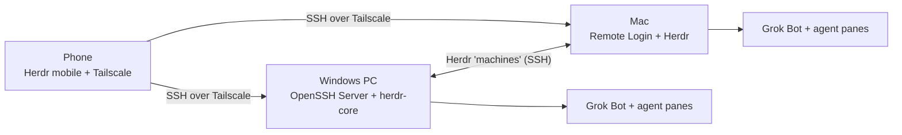

# Phone: Herdr mobile over Tailscale SSH

Use the agents from your phone. The Herdr mobile app connects over **SSH** to the PC (and the Mac). The SSH
connection goes through **Tailscale**, a private network between your own devices. Nothing is open to the internet.

This page is the **method only**. It has no real names, users or addresses. Use your own values where you see:

| Placeholder | Means |
|---|---|
| `{{TAILSCALE_PC}}` | the PC's Tailscale device name (Tailscale app → Machines) |
| `{{TAILSCALE_MAC}}` | the Mac's Tailscale device name |
| `{{WIN_USER}}` | your Windows user name |
| `{{MAC_USER}}` | your Mac user name |

Never write the real values into this repo.



How sure: the PC side was set up and used on the source PC (owner's notes, 2026-11-15). The `hc machine add`
syntax was read from `hc.exe machine add --help` on the source PC. The Herdr mobile menu names and the Mac side are
**UNVERIFIED** here. For more, run `hc.exe --skill` (PC) or the Herdr help on the Mac.

## 1. PC side (Windows)

1. **Tailscale**: install the Tailscale app for Windows and sign in. Check: the app shows the PC as connected.
2. **OpenSSH Server**, in an **admin PowerShell** (standard Windows commands):

   ```powershell
   Add-WindowsCapability -Online -Name OpenSSH.Server~~~~0.0.1.0
   Set-Service -Name sshd -StartupType Automatic
   Start-Service sshd
   ```

   Check: `Get-Service sshd` shows `Running`.
3. **Firewall: SSH only from Tailscale.** Allow port 22 only from the Tailscale range `100.64.0.0/10` (this range
   is public knowledge, the same for every Tailscale user):

   ```powershell
   New-NetFirewallRule -Name sshd-tailscale -DisplayName "OpenSSH (Tailscale only)" -Direction Inbound -Protocol TCP -LocalPort 22 -RemoteAddress 100.64.0.0/10 -Action Allow
   ```

   If Windows already made a rule named `OpenSSH-Server-In-TCP` that allows any address, limit or disable it:
   `Set-NetFirewallRule -Name OpenSSH-Server-In-TCP -RemoteAddress 100.64.0.0/10`.
4. **Keys (better than a password)**: put the phone's public key (and the Mac's) in the Windows user's
   `.ssh\authorized_keys`. For an admin account, Windows reads `C:\ProgramData\ssh\administrators_authorized_keys`
   instead. Never copy a private key into this repo.
5. **Herdr** must be running on the PC (herdr-core keeps terminals alive when the window is closed).

## 2. Mac side

1. **Tailscale**: install and sign in.
2. **Remote Login** (SSH): System Settings → General → Sharing → Remote Login: on. Allow only your user.
3. Put the phone's public key in `~/.ssh/authorized_keys` on the Mac.
4. Herdr for Mac running. Details of the Mac Herdr setup: `setup/mac/README.md` (UNVERIFIED draft until the Mac fills it).

## 3. Phone side

1. Install **Tailscale** and sign in with the same account. Check: you see `{{TAILSCALE_PC}}` and `{{TAILSCALE_MAC}}`.
2. Install **Herdr mobile**.
3. Add a host for the PC: address `{{TAILSCALE_PC}}`, user `{{WIN_USER}}`, port 22, your SSH key.
4. Add a host for the Mac: address `{{TAILSCALE_MAC}}`, user `{{MAC_USER}}`, port 22, your SSH key.
5. Open the PC host. You see the Herdr spaces: Grok Bot and its agent panes. Type to Grok Bot as on the PC.

Tailscale must be **on** on both ends (phone and PC, or phone and Mac).

## 4. PC and Mac see each other (two-way)

Each Herdr can show the other computer as a "machine":

| On | Machine | How |
|---|---|---|
| PC | `mac` | `hc.exe machine add {{MAC_USER}}@{{TAILSCALE_MAC}} --name mac` (syntax from `hc.exe machine add --help` on the source PC: the target is "how ssh reaches it"). The SSH key lives in the Windows user's `.ssh` folder |
| Mac | the PC | the same on the Mac: `hc machine add {{WIN_USER}}@{{TAILSCALE_PC}} --name pc` (UNVERIFIED on the Mac: the Mac `hc` was not checked) |

List machines: `hc.exe machine ls`. Remove one: `hc.exe machine rm <name>`.

Check from the PC: `ssh {{MAC_USER}}@{{TAILSCALE_MAC}} echo ok` prints `ok`.
Check from the Mac: `ssh {{WIN_USER}}@{{TAILSCALE_PC}} echo ok` prints `ok`.

## 5. Safety

- SSH listens only to the Tailscale range. Do not open port 22 on your router.
- Use keys, not passwords. Keep private keys on their device.
- Do not run `hc server stop` or `hc server restart` from the phone either: it kills every terminal.
- Lost phone: remove it in the Tailscale admin page, and remove its key from `authorized_keys`.

## 6. If it does not connect

| Symptom | Check |
|---|---|
| Phone cannot reach the host | Tailscale on, on both ends? Same Tailscale account? |
| "Connection refused" | PC: `Get-Service sshd` running? Mac: Remote Login on? |
| "Connection timed out" | PC firewall rule present (`Get-NetFirewallRule -Name sshd-tailscale`)? |
| "Permission denied (publickey)" | key in the right file (admin accounts: `administrators_authorized_keys`) |
| Connected, but no Grok Bot | Herdr running on that computer? Start one with `gbh` (PC) |
