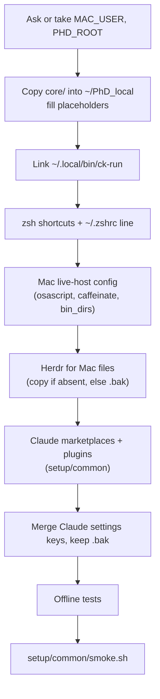

# setup/mac

> **DRAFT, UNVERIFIED: the Mac finishes this (`docs/MAC_HANDOFF.md`).**
> Written on the Windows PC from the old Mac line in `archive/ck-dispatch-2026-11-15/` and the Windows setup.
> Nothing here was run on a Mac. The Mac's Claude replaces this page with the tested version.
> `setup/mac/setup.sh` does **not** exist yet.

## What the Mac part must contain

| File | What it must do | Model on the PC side |
|---|---|---|
| `setup/mac/setup.sh` | Idempotent installer. `--dry-run` prints every action and changes nothing. `--yes` uses the values given, no prompts. Accepts or asks for `MAC_USER` and `PHD_ROOT`. | `setup/windows/setup.sh` + `setup_support.py` |
| `setup/mac/README.md` | This page, tested: new-Mac checklist, flags, checks, what is not included | `README.md` "New Windows PC" + `AGENT_SETUP.md` |
| zsh shortcuts | `cdev`, `cnv`, `gb`, `phd` as in `setup/windows/wsl/ck_shortcuts.sh`, sourced from `~/.zshrc` | `setup/windows/wsl/ck_shortcuts.sh` |
| Herdr for Mac files | layout, mods (green done, yellow needs you), settings, keys, themes. Copy only if absent, else keep a `.bak` | `setup/windows/herdr/`, `setup.cmd` `:copy_pref` |
| Mac config for ck-run | `live.osascript`, `live.caffeinate`, `bin_dirs` for macOS (see below) | `core/ck-dispatch/config/workspaces.json` (PC values) |
| Live host | `core/ck-dispatch/platform/mac/` (see its README) | `platform/herdr`, `platform/wsl`, `platform/auto` |

## What setup.sh should do (proposed order)

1. Values: `MAC_USER` (default `$USER`), `PHD_ROOT` (a Mac path; ask, no guess). Same safety checks as the Windows
   installer: absolute paths, no shell metacharacters, nothing written outside `$HOME`, never through a symlink.
2. Copy `core/ck-dispatch`, `core/ckstack`, `core/grokbot-mod`, `core/skills` into `~/PhD_local/ck-dispatch`,
   `ckstack`, `grokbot-mod`, `grok-bot-skills`, and fill `{{PHD_ROOT}}`, `{{LOCAL_ROOT}}`, `{{ONEDRIVE_ROOT}}`, and
   the Mac values (`{{MAC_USER}}`, `{{MAC_HOME}}` are reserved in `setup/common/placeholders.json`).
3. Link `~/.local/bin/ck-run` → `~/PhD_local/ck-dispatch/bin/ck-run`.
4. Write the zsh shortcuts and one source line at the top of `~/.zshrc`.
5. Set the Mac live-host config (next section).
6. Copy the Herdr for Mac files. Where Herdr for Mac keeps its config: UNKNOWN (find it on the Mac).
7. Claude plugins: the same lines as Windows (`setup/common/claude/marketplaces.json`, `plugins.txt`), the plugin
   prefs (`setup/common/claude/store/`), and the settings merge (`setup/common/claude/settings.json`).
8. Offline tests: `python3 -I ~/PhD_local/ck-dispatch/tests/run_all.py`. Then `bash setup/common/smoke.sh`.

## The Mac live-host config (from the old Mac line)

The old Mac config (`archive/ck-dispatch-2026-11-15/config/workspaces.json`, block `live`) had:

| Key | Old Mac value | PC value today |
|---|---|---|
| `live.terminal` | `iTerm2` | `iTerm2` (the PC stand-ins answer the iTerm2 calls) |
| `live.osascript` | `/usr/bin/osascript` | `~/PhD_local/ck-dispatch/platform/auto/osascript` |
| `live.caffeinate` | not set: ck-run's default `/usr/bin/caffeinate` | the WSL stand-in `platform/wsl/caffeinate` |
| `bin_dirs` | includes `/opt/homebrew/bin` | no Homebrew |
| `live.keep_awake` | `true` | `true` |
| `live.close_tab_after_s` | `300` | `300` |

Important: `platform/auto/osascript` reads `/proc`, which macOS does not have. On a Mac it would fall back to the
WSL tmux script. So the Mac config must **not** use it.

## iTerm2 (the old Mac default host)

From `archive/ck-dispatch-2026-11-15/README.md` ("Live mode") and `ckdispatch/live.py`:

- One iTerm2 window per ask, one tab per run. The window's session **runs** `<run>/live.sh` (nothing is typed).
- Window name `CK · <agent> · <title> · <id>`.
- Per-agent iTerm2 profiles in `~/Library/Application Support/iTerm2/DynamicProfiles/ck-run-live.json`
  (`CK Live claude|codex|cursor|agy`): own tab color and badge, "Allow Title Setting" off.
- Colors: `core/ck-dispatch/config/iterm_colors.json`.
- macOS will ask once to let the terminal control iTerm2 (Automation permission). The owner clicks Allow.
  UNVERIFIED wording.

## Keep awake

ck-run runs `/usr/bin/caffeinate -i -w <ck-run pid>` while a live run waits (`live.keep_awake`). It stops idle sleep
only, not sleep when the lid closes on battery.

## Herdr for Mac (the old Mac line)

The old Mac line put Herdr **inside** ck-run (`archive/ck-dispatch-2026-11-15/ckdispatch/herdr.py`):

- Host choice: `CK_RUN_HOST=iterm` or `CK_RUN_HOST=herdr:<main terminal id>`. Without it: `HC_TERMINAL_ID` set →
  Herdr beside that terminal; else the configured terminal (iTerm2).
- `ck-run launch` wrote `export CK_RUN_HOST=...` into the launch script, so a rerun used the same host.
- Tools: `hc` and `herdr-app` from the PATH, or `~/.local/bin/hc`, `~/.local/bin/herdr-app` (override:
  `CK_HERDR_HC`, `CK_HERDR_APP`).
- Layout: main terminal left half, agents stacked right with equal weights (a version-checked `doc.set` on the
  `herdr-app` document).
- Pane state label `ck.state`: `done` (green), `needs` (yellow), `failed` (red).
- `live-host.json` in the run folder saved the terminal address for watchdog reads, resume and reattach.

The core in this repo has **no** `herdr.py`: the PC does Herdr through the `osascript` stand-ins instead. The Mac
picks one way (see `core/ck-dispatch/platform/mac/README.md`).

## Prerequisites (the owner does these)

Git, Python 3, `gh` (`gh auth login`), Claude Code (`claude`, then `/login`), Codex (`codex login`), Cursor agent
(`agent login`), agy (optional), iTerm2 and/or Herdr for Mac, Tailscale (phone only, `docs/PHONE.md`).
Install methods on the Mac: UNKNOWN until the Mac's inventory (Homebrew, vendor installers, ...).

## Checks the Mac must pass (from `docs/MAC_HANDOFF.md`)

- `bash setup/mac/setup.sh --dry-run` lists every action and changes nothing.
- `HOME=$(mktemp -d) bash setup/mac/setup.sh --yes ...` works, and a repeat install keeps the same files.
- `ck-run models` and `ck-run --help` work from that install.
- `python3 -I core/ck-dispatch/tests/run_all.py` still passes (Windows tests included).
- Privacy grep clean.
- With the owner's OK: a live smoke race (opus, sol, grok, `--mode auto`) on the Mac.

## Open points for the Mac (UNKNOWN on the PC)

1. Where is this Mac's live ck-dispatch, and how does it differ from `core/ck-dispatch`?
2. iTerm2, Herdr for Mac, or both? Which is the default?
3. Herdr for Mac config folder and file names.
4. How the agent CLIs were installed on the Mac.
5. The zsh shortcut names in use (`cdev`, `cnv`, `gb`, `grokbot`, ...).
